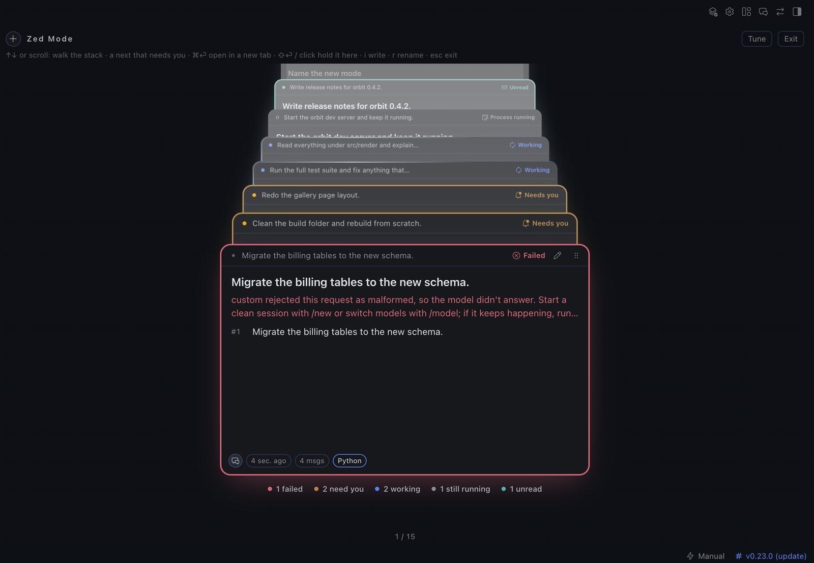
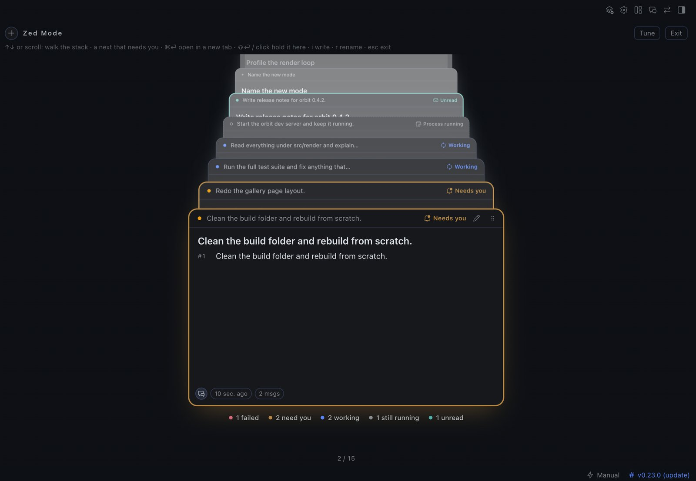
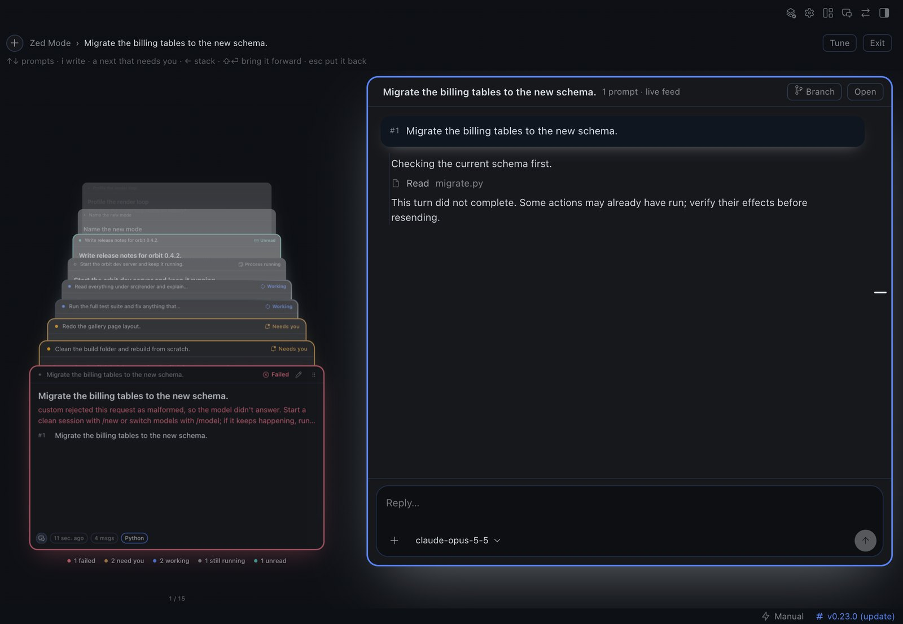

# Zed Mode

**Every Hermes conversation in one stack that recedes into the screen, ordered like an inbox.**
A plugin for the [Hermes](https://hermes-agent.nousresearch.com/docs) desktop app.

> **Status: early beta (0.19.0).** Built and tested against Hermes **v0.23.0** on **macOS**.
> See [Compatibility](#compatibility) for what that does and doesn't promise.



*The screenshots in this README use sample conversations.*

## What it does

Press **⌘⌥Z** (or the layers icon in the titlebar) and your conversations lift into a single
stack. The front of the stack is whatever needs you most:

| Front → back | State |
|---|---|
| 1 | **Failed**: red edge, the error on the card |
| 2 | **Needs you**: amber edge; an approval or a question |
| 3 | **Working**: the app's own running arc, and what the agent is doing right now |
| 4 | **Process running**: a dev server that outlived its turn |
| 5 | **Unread**: finished while you were away |
| 6 | **Pinned** |
| 7 | Everything else, most recent first |

On a quiet day the front of the stack is your pins (pin a chat in the Hermes sidebar). States come from the app's own status dot,
so Zed Mode agrees with the sidebar.

- **Answer on the card.** An approval shows the exact command and the choices the gateway allows;
  a question shows its choices. One click answers that one request. **⇧Y** / **⇧N** approve once /
  deny, and are shifted on purpose so a stray keypress can't approve a command.


- **Hold a conversation (⇧⏎).** The stack steps aside and the conversation floats in beside it as a
  thread: sticky prompts, a prompt rail, edit cards in your theme's colours, and a composer with
  images, files, URLs, the real model menu and Stop. Hold again to bring it to the foreground.


- **Start and branch chats without leaving Zed Mode**: the round **+** (new chat, optionally in a
  folder) and the **Branch** icon on a prompt.
- **Tune the 3D live** (**`**): sliders, presets and shareable `zed1.…` codes.

Plain ⏎ never opens a chat; it is left for typing. **Esc** steps back one level at a time, all the
way to classic Hermes.

## Quick start

```bash
git clone https://github.com/latentJake/hermes-zenmode.git
cd hermes-zenmode
./scripts/install.sh
```

Then in Hermes: **⌘K → Reload desktop plugins**, and press **⌘⌥Z**. Details, what the installer
changes, and troubleshooting are in [docs/quickstart.md](docs/quickstart.md).

## Keys

| | |
|---|---|
| **⌘⌥Z** | open / close Zed Mode |
| **↑ ↓** (or **k j**, **⇥ ⇧⇥**) | one card deeper / closer |
| **⇧⏎** or **space** | hold the front card; **⇧⏎** again: foreground |
| **⌘⏎** | open in classic Hermes, in a new tab |
| **i** or **/** | write in the conversation |
| **a** | jump to the next conversation that needs you |
| **⇧Y / ⇧N** | approve once / deny the front card's request |
| **esc** | back one level |

Everything else, including mouse actions, is in [docs/keybinds.md](docs/keybinds.md).

## Compatibility

| | |
|---|---|
| **Hermes** | Requires **≥ 0.23.0** (`plugin.yaml`). Developed and tested on **v0.23.0**. Newer versions are untested. |
| **OS** | **macOS** only is tested. The plugin SDK is cross-platform, but nothing here has been run on Windows or Linux (the shortcut would be Ctrl+Alt+Z). |
| **Needs** | The Hermes desktop app. The CLI and web dashboard alone don't load desktop plugins. |
| **Backend** | A small Python half runs inside the gateway for pins and old transcripts. Without it, Zed Mode still works for live conversations. |

Zed Mode leans on a few parts of Hermes that are **not** documented plugin APIs. Which ones, how each
fails, and what you'd see are listed in [docs/compatibility.md](docs/compatibility.md).

## What it touches

| | |
|---|---|
| **Network** | None. No telemetry, no remote code, no updater. |
| **Reads** | Your session list and transcripts, read-only. `state.db` is opened read-only with `query_only`; live conversations come through the desktop SDK. Titles and folder paths appear on cards. |
| **Writes** | Only its own files: your tuning and presets and a short list of failed turns (the plugin's storage in the app), and a cache of derived card facts at `$HERMES_HOME/plugin-data/zedmode/cache.db`. Never `state.db`. Pins are Hermes's own (pin a chat in the sidebar); Zed Mode only reads them. |
| **Acts for you** | Only what you click or type in Zed Mode: send a prompt, answer an approval or question, rename, start or branch a chat, switch a live chat's model or reasoning effort. Each goes through the same gateway request the app itself sends. Approvals are never answered automatically. |
| **Credentials** | None read, stored or sent. |
| **Processes** | None started. The Python half is a request handler inside the Hermes gateway. |
| **One private seam** | To explain *why* a model can't be used, the backend calls Hermes' own model resolver. It isn't a public API; if it changes, Zed Mode shows the gateway's short reason instead. |

The desktop half is opt-in, and the Python half only runs once `zedmode` is listed under
`plugins.enabled`. `scripts/install.sh` adds that line (with a backup); it is a script you run by hand.

## Known limits

- **Unread and "process running" depend on how the app paints its status dot.** If a Hermes update
  changes that, those two states silently drop out of the ordering; the others keep working.
- **A failure is seen only while the app is open.** A turn that fails while Hermes is closed won't
  show as failed.
- **A conversation that isn't live can't take a message from Zed Mode**, nor be branched from a single
  prompt. Zed Mode shows its transcript and keeps your text; **Open** continues it in Hermes.
- **Visual behaviour is checked by hand on one machine.** The automated suite has no layout or 3D,
  so spatial polish is not something it can vouch for.
- The 3D **PAPER** thread is parked behind an experimental dial.

## Documentation

| | |
|---|---|
| [Quick start](docs/quickstart.md) | Install, first run, troubleshooting, uninstall |
| [Keys and mouse](docs/keybinds.md) | The full reference |
| [Tuning](docs/tuning.md) | The dials, presets and share codes |
| [Compatibility](docs/compatibility.md) | Versions, what we depend on, failure modes |
| [Architecture](docs/architecture.md) | How the two halves work |
| [Design](docs/design.md) | The rules the UI follows |
| [Development](docs/development.md) | Tests, the promote gate, writing your own plugin |
| [Roadmap](docs/roadmap.md) | What's next |
| [Changelog](CHANGELOG.md) | Releases |

## License

[MIT](LICENSE)
